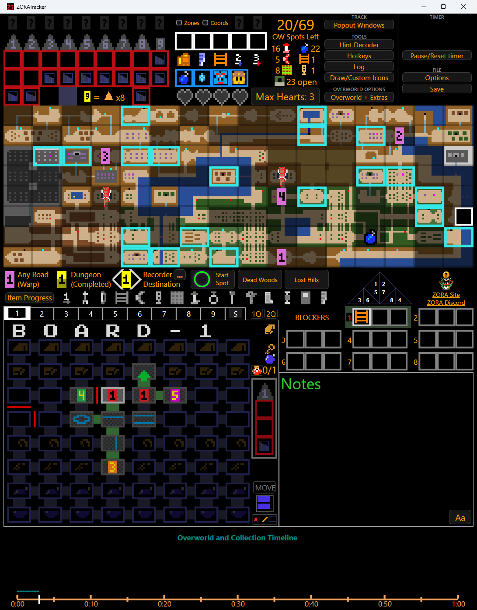
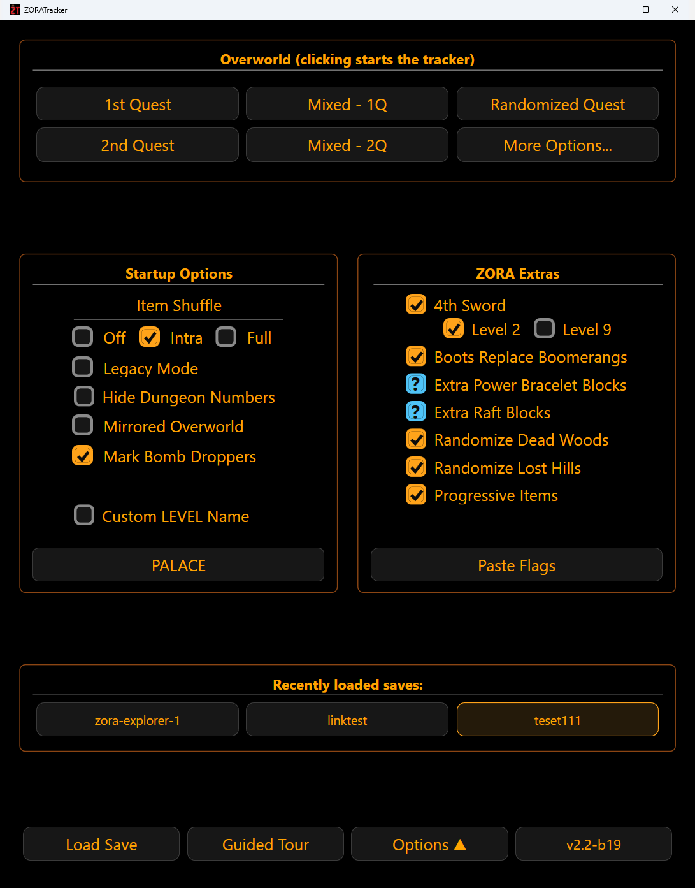

# ZORATracker

### Track your whole Zelda 1 Randomizer run in one window.

A tracker for [ZORA](https://zora.gg) (Zelda One Randomizer Addons) and Z1R racers, casual and competitive.
Free your head for the run: the tracker remembers where everything is.

**[Download](https://github.com/TheGobOne/ZoraTracker/releases/latest)** · **[Guides](#guides)** · **[Report a bug](https://github.com/TheGobOne/ZoraTracker/issues)**

 

## Quick start (Windows)

Needs Windows 10 (version 1903 or later) or Windows 11. The tracker uses .NET Framework 4.8, which those versions already include.

1. [Download the latest zip](https://github.com/TheGobOne/ZoraTracker/releases/latest) and unzip it somewhere you want to keep. Settings, hotkeys and saves live beside the program.
2. Run `Z1R_WPF.exe`. If Windows warns about an unknown app, choose **More info**, then **Run anyway**.
3. On the start screen, click **Paste Flags**, paste your Z1R and ZORA flag strings, and click **Apply**.
4. Click the overworld your seed uses (1st Quest, 2nd Quest, Mixed or Randomized). The tracker starts.

Stuck? Click **Guided Tour** on the start screen. The app also checks for new releases and tells you when one is available.

## What it tracks

| | |
|---|---|
| **Items and hearts** | Mark what you own, with live counts of overworld spots left. |
| **Overworld map** | Caves, shops, dungeon entrances and hints, with routing lines when you hover a tile. |
| **Every dungeon** | Room by room: types, contents, doors, OFF rooms. A summary tab shows all nine at once. |
| **Hints and blockers** | A Hint Decoder, Dead Woods and Lost Hills boxes, and per-dungeon blockers. |
| **Your run** | A timeline of what you found and when, free-text notes, and a run timer. |
| **Reminders** | Voice and visual nudges for things worth checking, configurable in Options. |
| **Keyboard play** | Map hotkeys to items, tiles, rooms and doors. |
| **Streaming and co-op** | Popout windows, a broadcast window, and Co-Op host/client settings. |
| **Saves** | Manual and auto-save, with your recent saves one click away. |

## Guides

| Guide | Covers |
|---|---|
| [Getting started](doc/getting-started.md) | Install, first run, saves, updating |
| [Start screen](doc/start-screen.md) | Overworld choice, Item Shuffle, ZORA Extras, Paste Flags |
| [Main screen](doc/main-screen.md) | Items, map, tools, timeline |
| [Dungeons](doc/dungeons.md) | Rooms, doors, OFF rooms, clearing a dungeon |
| [Hotkeys](doc/hotkeys.md) | Playing from the keyboard |
| [Options](doc/options.md) | Every setting |

## What it does not do (yet)

- **Windows only today.** The tracker is a native Windows (WPF) app.
- **Mac, Linux and browser are in progress.** A cross-platform [Avalonia](https://avaloniaui.net) port exists but has not reached parity with the Windows version. See its [progress log](docs/avalonia-port/PROGRESS.md).
- **Releases are betas.** Expect rough edges and please report them.

## Feedback

Found a bug or have an idea? [Open an issue](https://github.com/TheGobOne/ZoraTracker/issues) or ask in the [ZORA Discord](https://discord.gg/zescSjDtme) or the [Z1R Racing Discord](https://discord.gg/z1rracing). If the app crashed, attach the log from **Options, Show Crash Log...**.

## Credits

- **Lorgon (Brian McNamara)**, creator of Z-Tracker, which this project builds on ([original repo](https://github.com/brianmcn/Zelda1RandoTools)).
- **Neonane**, whose fork of Z-Tracker this continues from.
- **tetraly**, the cross-platform Avalonia port.

Thanks to everyone who tested and reported bugs.

## License

[MIT](LICENSE.txt)
