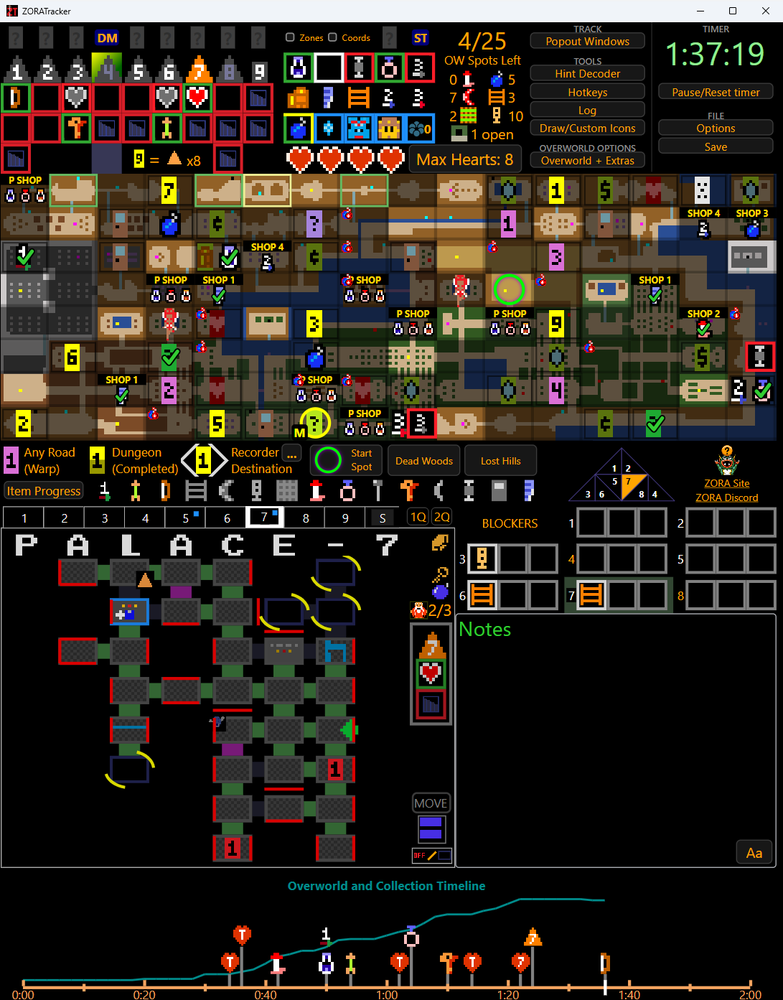
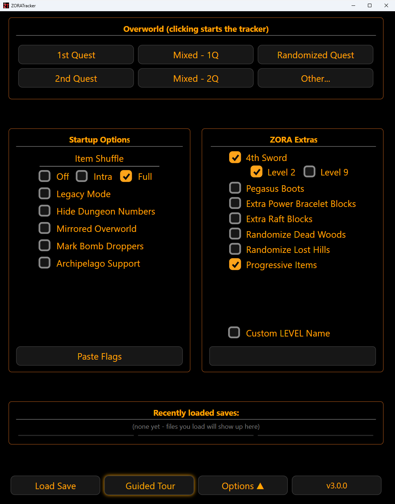

# ZORATracker

### Track your whole Zelda 1 Randomizer run in one window.

A tracker for [ZORA](https://zora.gg) (Zelda One Randomizer App) and Z1R racers, casual and competitive.
Free your head for the run: the tracker remembers where everything is.

**[Open in browser](https://zoratracker.gg)** · **[Download](https://github.com/TheGobOne/ZoraTracker/releases/latest)** · **[Guides](#guides)** · **[Report a bug](https://github.com/TheGobOne/ZoraTracker/issues)**

 

## Install

Pick one.

| Where | How |
|---|---|
| Browser | Open [zoratracker.gg](https://zoratracker.gg). Nothing to install. |
| Windows | Download the Windows zip from the [latest release](https://github.com/TheGobOne/ZoraTracker/releases/latest) (the `ZoraTracker-CrossPlatform` zip with no `macOS` or `linux` in its name). Unzip it somewhere you want to keep, then run `ZoraTracker.CrossPlatform.exe`. If Windows warns about an unknown app, choose **More info**, then **Run anyway**. Settings, hotkeys and saves live beside the program. |
| macOS | Download `ZoraTracker-CrossPlatform-v<version>-macOS-arm64.zip` (Apple silicon) or `...-macOS-x64.zip` (Intel) from the [latest release](https://github.com/TheGobOne/ZoraTracker/releases/latest). Unzip it and move `ZORATracker.app` to Applications. The app is only ad-hoc signed, so the first time, right-click it and choose **Open**. When upgrading, delete the old `ZORA Tracker.app` first. Settings and saves are kept. They live in `~/Library/Application Support/ZoraTracker`. |
| Linux | Download `ZoraTracker-CrossPlatform-v<version>-linux-x64.zip` from the [latest release](https://github.com/TheGobOne/ZoraTracker/releases/latest), unzip it, and run `./ZoraTracker.CrossPlatform`. Settings and saves live in `~/.config/ZoraTracker` (or `$XDG_CONFIG_HOME/ZoraTracker`). |

The desktop builds are self-contained, so you do not need to install .NET on macOS or Linux.

How well each one is tested:

- Windows and the browser are the main targets.
- Linux has minimal testing.
- Co-op has no official testing on macOS or Linux.

## Quick start

1. Open the tracker. You land on the start screen.
2. Click **Paste Flags**, paste the Z1R and ZORA flag strings from the ZORA site (or a seed file name, or drop the seed file on the dialog), and click **Apply**.
3. Click the overworld your seed uses: 1st Quest, 2nd Quest, Mixed - 1Q, Mixed - 2Q or Randomized Quest. The tracker starts.

Stuck? Click **Guided Tour** on the start screen. The desktop app checks for new releases and tells you when one is available. The browser version updates on your next visit.

## What it tracks

| | |
|---|---|
| Items and hearts | Mark what you own, with live counts of overworld spots left. |
| Overworld map | Caves, shops, dungeon entrances and hints, with routing lines when you hover a tile. |
| Every dungeon | Room by room: types, contents, doors, OFF rooms. A summary tab shows every dungeon at once. |
| Hints and blockers | A Hint Decoder, Dead Woods and Lost Hills boxes, and per-dungeon blockers. |
| Your run | A timeline of what you found and when, free-text notes, and a run timer. |
| Reminders | Voice and visual nudges for things worth checking, configurable in Options. |
| Keyboard play | Map hotkeys to items, tiles, rooms and doors. |
| Streaming | Popout windows and a broadcast window. |
| Saves | Manual and auto-save, with your recent saves one click away. |
| Browser version | Runs at [zoratracker.gg](https://zoratracker.gg). Saves and settings stay in your browser. If you open it in two tabs, only one tab saves, and the other says so. |
| Hosted co-op | Enter `https://coop.zoratracker.gg` in **Co-op client settings** to track with a partner. Desktop and browser trackers can play together. Each field has its own version, so the newest change wins. The desktop app also has **Co-op host settings** if you want to host. |
| Archipelago support | Turn on **Archipelago Support** (start screen or Options) to place the AP Item, an item that belongs to another world in a multiworld game. |
| Paste Flags | Paste flag strings or a seed file name, or drop a seed file or a tracker save on the dialog, to fill both flag strings. Your ZORA flags are saved with the save file. |
| 4th Sword | In ZORA Extras. Turning on 4th Sword also turns on Progressive Items. Turning on Progressive Items does not turn on 4th Sword. |

## Guides

| Guide | Covers |
|---|---|
| [Getting started](doc/getting-started.md) | Install, first run, saves, updating |
| [Start screen](doc/start-screen.md) | Overworld choice, Item Shuffle, ZORA Extras, Paste Flags |
| [Main screen](doc/main-screen.md) | Items, map, tools, timeline |
| [Dungeons](doc/dungeons.md) | Rooms, doors, OFF rooms, clearing a dungeon |
| [Hotkeys](doc/hotkeys.md) | Playing from the keyboard |
| [Options](doc/options.md) | Every setting |

The guides were written for the Windows build. File names and folders in them may differ on macOS, Linux and the browser.

## What it does not do

- Speech recognition works on Windows only. It is not being ported to macOS or Linux.
- Voice reminders on macOS use the system `say` command. On Linux they need `espeak-ng`, `espeak` or `spd-say`. Neither has been run on a real machine yet.
- The in-app update install is Windows only. On macOS and Linux the version button opens the release page.
- It does not track other randomizers.

## Feedback

Found a bug or have an idea? [Open an issue](https://github.com/TheGobOne/ZoraTracker/issues) or ask in the [ZORA Discord](https://discord.gg/zescSjDtme) or the [Z1R Racing Discord](https://discord.gg/z1rracing). If the app crashed, attach the log from **Options, Show Crash Log...**.

## Credits

- **Lorgon (Brian McNamara)**, creator of Z-Tracker, which this project builds on ([original repo](https://github.com/brianmcn/Zelda1RandoTools)).
- **Neonane**, whose fork of Z-Tracker this continues from.
- **tetraly**, who wrote the cross-platform Avalonia port that 3.0 is built on.

Thanks to everyone who tested and reported bugs.

## License

[MIT](LICENSE.txt)
