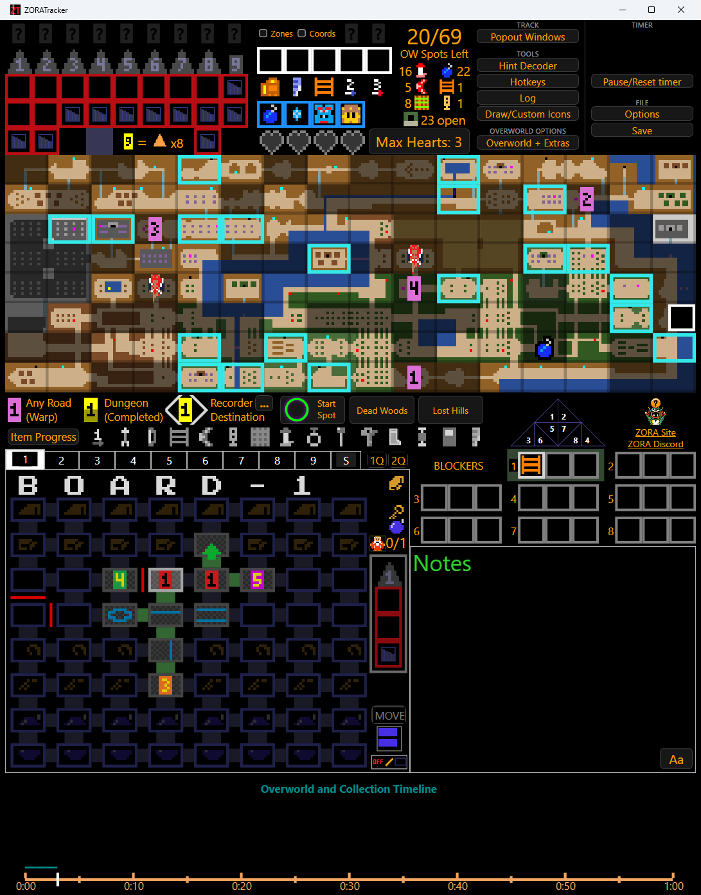

# Main screen

[Home](../README.md) · [Getting started](getting-started.md) · [Start screen](start-screen.md) · **Main screen** · [Dungeons](dungeons.md) · [Hotkeys](hotkeys.md) · [Options](options.md)

## Top: triforces, items and counters

- **Triforces and levels** along the top. Mark each dungeon as you finish it.
- **Dungeon item boxes**: one row per dungeon holding what you found there. Click a box to set its item. A green border means collected.
- **Triforce in the basement**: some seeds hide a triforce piece in a basement. Click a dungeon item box and choose Triforce Piece. The numbered triforce moves into that box, and you will have an extra floor item to make up for it.
- **Items and hearts**: the items you own, your hearts and Max Hearts. Click to mark them.
- **Counters**: how many overworld spots are left, plus counts of items and open spots.

## Tools and file

- **Popout Windows** opens extra windows (such as Spot Summary and Current Equipment) you can place anywhere, including for streaming.
- **Hint Decoder** helps with hints.
- **Hotkeys** shows the keyboard shortcuts you have mapped.
- **Log** shows the reminders that have played.
- **Draw/Custom Icons** lets you draw on the map.
- **Overworld + Extras** sets the quest and block options, including any [Random ZORA options](start-screen.md#random-options).
- **Pause/Reset timer** controls the run clock.
- **Options** opens [settings](options.md).
- **Save** writes a save file.

## Overworld map

Click a tile to mark what is there: caves, shops, dungeon entrances and more. Right-click for more choices. Hover a tile to see routing lines, and use the magnifier for a closer look. Fill in details as you explore.

Under the map is the **marker legend**: Any Road (warp), completed dungeon, recorder destination, your **Start Spot**, and boxes for your **Dead Woods** and **Lost Hills** hints.

## Item Progress

A quick view of the items and upgrades you have collected. Hover **Item Progress** to see what is left to find.

## Dungeons, blockers and notes

- **Dungeon tabs** 1 to 9 and **S** (summary). **1Q** and **2Q** switch between the first and second quest layouts. See [Dungeons](dungeons.md).
- **Dungeon boards** show a small map of each dungeon. Hover to preview a tab, click to switch to it.
- **Blockers**: note what blocks each dungeon so you remember what you still need.
- **Notes**: free text for the run. **Aa** changes the text size.
- **Timeline**: when you found each item and how the overworld filled in, with the seed and flags along the top.

## Menus

Item, tile and room menus that open when you click can be rearranged. Click the **LOCKED** bar on a menu to unlock it, drag the bar to move it, drag the corner grip to resize it, then lock it again. Your layout is remembered.
