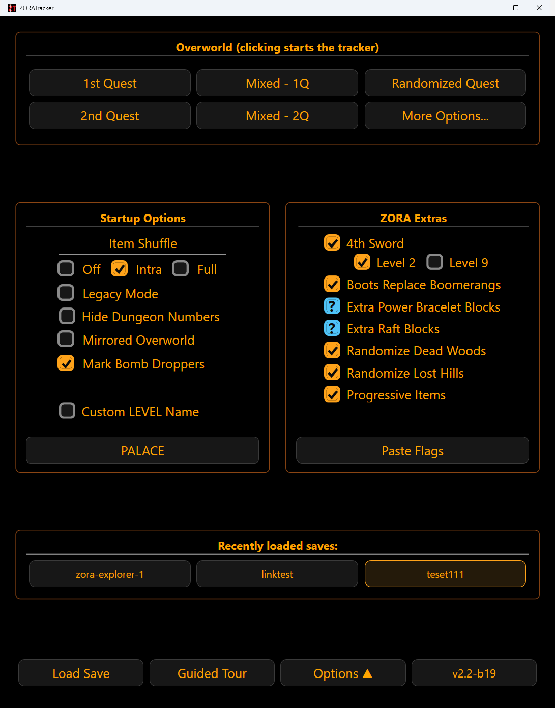

# Start screen

[Home](../README.md) · [Getting started](getting-started.md) · **Start screen** · [Main screen](main-screen.md) · [Dungeons](dungeons.md) · [Hotkeys](hotkeys.md) · [Options](options.md)

Set these before you begin a run. Most can be changed later from the main screen.

- [Choose your overworld](#choose-your-overworld)
- [Item Shuffle](#item-shuffle)
- [Startup options](#startup-options)
- [Hide Dungeon Numbers](#hide-dungeon-numbers)
- [ZORA Extras](#zora-extras)
- [Paste Flags](#paste-flags)
- [Saves, tour and version](#saves-tour-and-version)

## Choose your overworld

Click the overworld your seed uses to start a new run: **1st Quest**, **2nd Quest**, **Mixed - 1Q**, **Mixed - 2Q** or **Randomized Quest**. This picks the map drawing and the set of spots that can hold an entrance, and fills in the Spot Summary with what you will eventually find.

If you do not know which quest your seed uses, pick a Mixed option. You may need to adjust slightly if you turn out to be in a different quest.

## Item Shuffle

Match how the seed shuffled heart containers: **Off**, **Intra** or **Full**. With it Off, the first item box of each of the first eight dungeons starts with a Heart Container.

## Startup options

- **Legacy Mode** limits shops to the original game's items.
- **Hide Dungeon Numbers** hides the level numbers. See [below](#hide-dungeon-numbers).
- **Mirrored Overworld** flips the map.
- **Mark Bomb Droppers** lets you mark bomb-dropper spots.
- **Custom LEVEL Name** replaces `LEVEL-n` with a name. It only works with ZORA seeds, so leave it off otherwise.

## Hide Dungeon Numbers

Use this when your seed hides which dungeon is which number.

- Dungeons are labeled **A-H** instead of 1-8, on the triforces, tabs, map tiles and blockers.
- When you first meet a dungeon, give it the first unused letter. That letter stays its name.
- Optionally mark the dungeon's floor color with the rainbow letter or the button above its triforce. Colors are for your reference only.
- When you collect the triforce, the number chooser pops up. Set the real number once you know it. Numbers affect reminders and other features, so set it as soon as you can.

## ZORA Extras

Options that only some ZORA seeds use. The checkbox beside the header toggles all of them.

- **4th Sword** adds a fourth sword level above the magical sword. Choose where its item lives: the level 2 staircase slot (the default) or a level 9 floor item. Checking it also turns on Progressive Items.
- **Progressive Items** makes the blue candle, blue ring, wood arrows and swords progressive.
- **Pegasus Boots**, **Extra Power Bracelet Blocks**, **Extra Raft Blocks**, **Randomize Dead Woods** and **Randomize Lost Hills**.

### Random options

Some flags are left to chance by the seed. Those boxes show a **?**.

- Random counts as **On**. Overworld tiles that might be blocked get a yellow dashed outline until you own the bracelet or raft, or enter the hint.
- **Boots** counts as Off until you confirm it.
- When the overworld opens with a Random option, a pointer shows you where to settle it: **Overworld + Extras** on the main screen. Each click cycles **Off, On, ?**, so a wrong click is easy to undo. Changes apply at once and are saved with your run.

## Paste Flags

Copy the Z1R and ZORA flag strings from the ZORA site, paste them in and click **Apply**. The matching options are ticked for you.

## Saves, tour and version

- **Recently loaded saves** lists your last three saves. **Load Save** opens any save file.
- **Guided Tour** walks through the start screen and the main screen.
- **Options** opens the settings panel. See [Options](options.md).
- The **version** button shows what is new and glows when an update is available.
