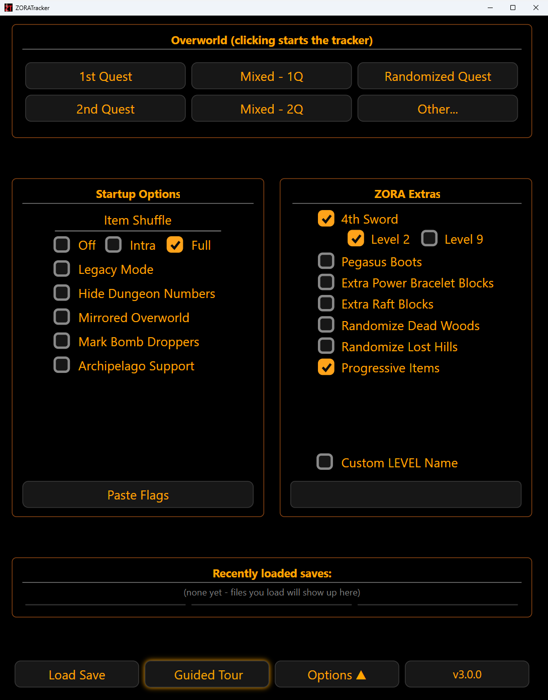

# Start screen

[Home](../README.md) · [Getting started](getting-started.md) · **Start screen** · [Main screen](main-screen.md) · [Dungeons](dungeons.md) · [Hotkeys](hotkeys.md) · [Options](options.md)

Set these before you begin a run. Most can be changed later from the main screen.

- [Choose your overworld](#choose-your-overworld)
- [Item Shuffle](#item-shuffle)
- [Startup options](#startup-options)
- [Hide Dungeon Numbers](#hide-dungeon-numbers)
- [Archipelago Items](#archipelago-items)
- [ZORA Extras](#zora-extras)
- [Paste Flags](#paste-flags)
- [Saves, tour and version](#saves-tour-and-version)

## Choose your overworld

Click the overworld your seed uses to start a new run: **1st Quest**, **2nd Quest**, **Mixed - 1Q**, **Mixed - 2Q** or **Randomized Quest**. This picks the map drawing and the set of spots that can hold an entrance, and fills in the Spot Summary with what you will eventually find. **Randomized Quest** does the same thing as **Mixed - 2Q**.

If you do not know which quest your seed uses, pick a Mixed option. You may need to adjust slightly if you turn out to be in a different quest.

**Other...** is for other Zelda 1 randomizers and ROM hacks with their own maps. You can track on a blank 16x8 grid, or pick a `.png` map file and start with it fully shown or with each tile hidden until you click it.

## Item Shuffle

Match how the seed shuffled items and hearts: **Off**, **Intra** or **Full**.

- **Off**: dungeon items stay in dungeons, with a heart on the floor of each dungeon.
- **Intra**: items can be anywhere, and hearts stay within dungeons (one heart per dungeon 1-8, which may be in a stair).
- **Full**: items and hearts are both shuffled.

## Startup options

- **Legacy Mode** is for non-ZORA seeds. It turns off and locks the ZORA Extras and limits shops to the original game's items.
- **Hide Dungeon Numbers** hides the level numbers. See [below](#hide-dungeon-numbers).
- **Mirrored Overworld** flips the map.
- **Mark Bomb Droppers** lets you mark bomb-dropper spots.
- **Archipelago Items** adds the AP Item. See [below](#archipelago-items).

## Hide Dungeon Numbers

Use this when your seed hides which dungeon is which number.

- Dungeons are labeled **A-H** instead of 1-8, on the triforces, tabs, map tiles and blockers.
- When you first meet a dungeon, give it the first unused letter. That letter stays its name.
- Optionally mark the dungeon's floor color with the rainbow letter or the button above its triforce. Colors are for your reference only.
- When you collect the triforce, the number chooser pops up. Set the real number once you know it. Numbers affect reminders and other features, so set it as soon as you can.

## Archipelago Items

For Archipelago multiworld games. It is off by default.

- Tick **Archipelago Items** here, or **Archipelago Items** in [Options](options.md). They are the same setting.
- The **AP Item** appears in the item-box menus and the overworld tile menu. It stands for an item that belongs to another world. Place it as many times as you need to mark checked locations.
- An **AP counter** appears next to the Zelda icon on the main screen. It counts the AP Items you have checked off as collected. Hover it to highlight the overworld spots that hold one.
- With the option off, the counter is hidden and you cannot place new AP Items.

## ZORA Extras

Options that only some ZORA seeds use. **Legacy Mode** turns them all off and locks them.

- **4th Sword** adds a fourth sword level above the magical sword. Choose where its item lives: **Level 2** (the level 2 staircase slot, the default) or **Level 9** (a level 9 floor item). Those two choices are available once 4th Sword is ticked.
- **Progressive Items** makes the blue candle, blue ring, wood arrows and swords progressive.
- **Shuffle** has three boxes: **Maps**, **Compasses** and **Triforces**. Tick the ones your seed shuffles between dungeons. They only record your choice for now.
- **Pegasus Boots** replaces the boomerangs with boots.
- **Extra Power Bracelet Blocks**, **Extra Raft Blocks**, **Randomize Dead Woods** and **Randomize Lost Hills**. Marking an Any Road inside one of these blocked areas makes that whole area count as reachable. The two raft areas count separately.
- **Custom LEVEL Name** replaces `LEVEL-n` at the top of each dungeon map with up to 7 letters or numbers. It only works with ZORA seeds, so leave it off otherwise.

### 4th Sword and Progressive Items

- Ticking **4th Sword** also ticks **Progressive Items**, and Progressive Items stays on while 4th Sword is on.
- Ticking **Progressive Items** does not tick 4th Sword.
- During a run, the 4th Sword setting is in **Overworld + Extras** on the main screen. Its label shows where the sword is: **4th sword: L9**, **4th sword: L2** or **4th sword: none**. Changing it moves whatever you marked in that slot.
- With Hide Dungeon Numbers on there is no level 2 staircase slot to show, so the choice is L9 or none, unless the start screen put the sword in level 2.

### Random options

Some flags are left to chance by the seed. Those boxes show a **?**.

- **Extra Power Bracelet Blocks**, **Extra Raft Blocks**, **Randomize Dead Woods** and **Randomize Lost Hills**: Random counts as **On**. Overworld tiles that might be blocked get a yellow outline.
- **Pegasus Boots**: Random counts as Off, so you keep the boomerangs until you confirm the boots.
- When the overworld opens with a Random option, a pointer shows you where to settle it: **Overworld + Extras** on the main screen. Each click cycles **Off, On, ?**, so a wrong click is easy to undo. Changes apply at once and are saved with your save file.

## Paste Flags

**Paste Flags** reads the flag strings from the ZORA site and ticks the matching options for you. It does not start the tracker: you still click an overworld.

Fill the dialog in any of these ways:

- Paste the Z1R flag string and the ZORA flag string into their boxes.
- Paste a seed file name (with or without `.nes`) into either box. Both flag strings are read from the name.
- Drop a seed file (`.nes`, `.spoiler.txt` or `.tracker.json`) on the dialog. Both flag strings are read from its name.
- Drop a tracker save, which can be a ZORATracker save or a ZORA tracker file. Its ZORA flags fill the ZORA box. A tracker file holds only the ZORA flags, so paste the Z1R flags too, or drop the seed's `.nes`.

Pasting applies at once. You can also click **Apply**, or press Enter in either box. Leave a box empty to leave those settings alone.

The dialog lists what each flag did under the boxes, for example `Checked: Progressive Items`, or `Random (?): Pegasus Boots, counts as Off until you set it in Overworld + Extras`. When there is something to read, **Close** becomes **Done**. Click **Done**, or press Enter once the boxes match what was last applied, to close the dialog. **Apply** closes the dialog by itself only when there is nothing to report.

- A seed that sets Item Shuffle, Mirrored Overworld or Hide Dungeon Numbers ticks those boxes. The overworld button for the seed's quest glows, so you know which to click.
- A seed with any ZORA Extra on unticks Legacy Mode.
- If the Z1R flags leave the quest or Item Shuffle at Random, the list tells you to set it yourself.
- Your ZORA flags are saved with the save file and come back when you load it.

## Saves, tour and version

- **Recently loaded saves** lists your last three saves. **Load Save** opens any save file.
- **Guided Tour** walks through the start screen and the main screen.
- **Options** opens the settings panel. See [Options](options.md).
- The **version** button shows what is new and glows green when an update is available. See [Updating](getting-started.md#updating).
